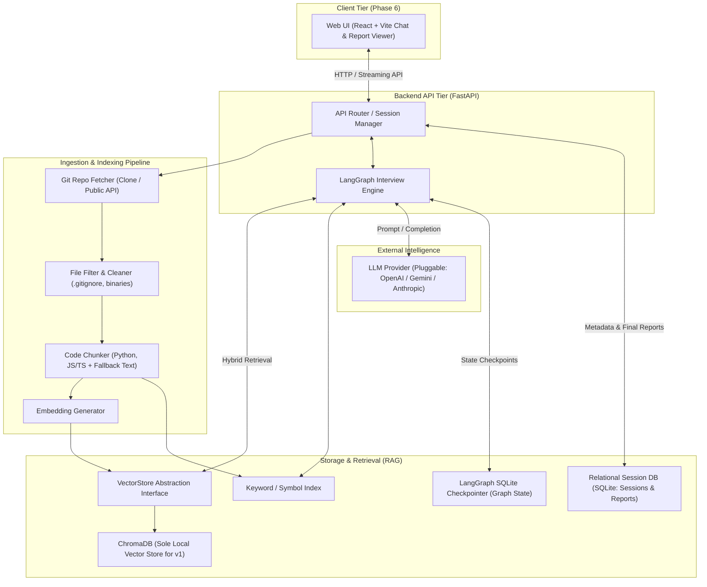
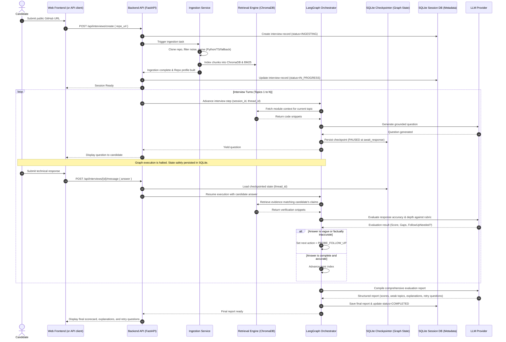
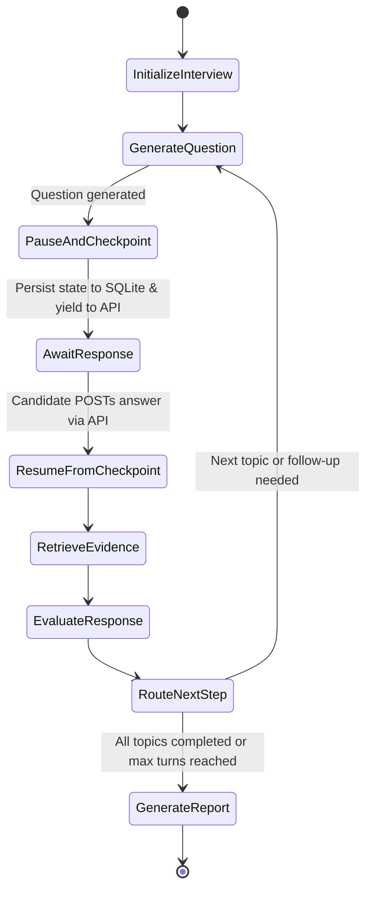

# GrillMe — System Architecture

This document describes the architectural design of **GrillMe**. It details system components, data flow, the Retrieval-Augmented Generation (RAG) pipeline, the LangGraph interview orchestration workflow, the proposed technology stack, key design trade-offs, security considerations, and the benchmark-based evaluation strategy.

---

## 1. High-Level System Architecture

GrillMe is structured into decoupled functional layers:
1. **Presentation Layer:** A clean chat and reporting user interface (React + Vite, developed in Phase 6 after the core backend flow is verified).
2. **API & Orchestration Layer:** FastAPI service managing sessions, endpoints, and LangGraph workflow execution with persistent state checkpointing.
3. **Ingestion & Knowledge Engine:** Git cloning, file filtering, language-specific parsing (Python and JavaScript/TypeScript initially, with fallback text chunking), and embedding generation.
4. **Retrieval & Fact-Checking Engine (RAG):** ChromaDB local vector storage (accessed via a clean storage abstraction) alongside keyword/symbol indexing to supply ground-truth evidence.
5. **LLM & Evaluation Services:** Prompt templates, question generators, fact-checking evaluators, and report synthesizers grounded in a verified benchmark rubric.



---

## 2. Main Components and Their Responsibilities

| Component | Responsibility |
|---|---|
| **Web Frontend (React + Vite)** | Captures repository URL, displays ingestion progress, renders real-time interview chat messages, and presents the structured final evaluation report. *Built in Phase 6 after backend flow is verified.* |
| **API Gateway / Backend (FastAPI)** | Manages interview session lifecycle, coordinates background ingestion tasks, provides turn endpoints, handles graph pause/resume transitions, and serves final reports. |
| **Ingestion Worker** | Clones public GitHub repositories into an isolated temporary workspace, applies exclusion filters, and builds an in-memory representation of project structure without executing repository code. |
| **Code Parser & Chunker** | Splits source code and documentation into semantically meaningful chunks. Implements initial syntax-aware parsing for **Python** and **JavaScript/TypeScript**, with an extensible parser interface and **fallback sliding-window text chunking** for other file types. |
| **Retrieval Engine (RAG)** | Performs dense vector search and sparse keyword/symbol matching to retrieve relevant code snippets. Backed by **ChromaDB** as the sole initial local vector store for v1, accessed through a minimal `VectorStore` abstraction interface to allow future engine replacements. *(Do not add Qdrant or other stores in v1).* |
| **LangGraph Orchestrator** | Governs the state machine of the interview: plans topics, generates questions, pauses at turns, persists checkpoints via SQLite, resumes upon receiving candidate answers, routes follow-ups, and aggregates scores. |
| **Answer Evaluator & Fact-Checker** | Assesses the candidate's answers against retrieved ground-truth code, scoring clarity, correctness, identifying weak topics, and noting factual discrepancies using fixed evaluation rubrics. |
| **Report Generator** | Synthesizes cumulative turn scores, evaluator notes, explanations, code references, and retry questions into a comprehensive, actionable performance scorecard. |

---

## 3. Data Flow: Repository Submission to Final Report



---

## 4. The RAG Pipeline

A naive text-based RAG pipeline fails when applied to source code because code is hierarchical and references are non-local. GrillMe addresses this through structured ingestion, language-specific parsing, and hybrid retrieval:

```
Source Code Files
       │
       ▼
[File Filtering] ──► Removes .git, binaries, tests/vendor if needed, lockfiles
       │
       ▼
[Parsing & Chunking]
       ├── Python (.py) ──────────────► AST / structural function & class chunks
       ├── JS/TS (.js, .jsx, .ts, .tsx)► Structural function, class & export chunks
       └── Unsupported Languages ────► Extensible Fallback Text Chunker (sliding window + overlap)
       │
       ▼
[Metadata Tagging] ──► { file_path, symbol, lines, language, imports }
       │
       ├──► VectorStore Interface ──► ChromaDB (Sole Local Vector Store for v1)
       └──► Sparse Index ────────────► BM25 (Exact symbol, class, and variable names)
```

### 4.1 Ingestion & Filtering Rules
- **Exclude Non-Code:** Images, audio, video, compiled binaries (`.so`, `.pyc`, `.exe`), package manager lockfiles (`package-lock.json`, `poetry.lock`), minified assets (`.min.js`), and vendor trees (`node_modules/`, `venv/`, `vendor/`).
- **Target Files:** Source code files, configuration manifests (`Dockerfile`, `docker-compose.yml`, `pyproject.toml`, `package.json`), and documentation (`README.md`).
- **Size Safeguard:** Single files larger than 100 KB or total repositories exceeding a predefined file limit (e.g., >500 source files for v1) are truncated or flagged to prevent context explosion.
- **Zero Execution Rule:** Cloned files are inspected strictly via static file reading and AST parsing; repository code is never compiled, run, or executed.

### 4.2 Language Parsing Strategy
- **Initial First-Class Languages:**
  - **Python (`.py`):** Structured parsing based on class, function, and async def boundaries with docstrings and signature preservation.
  - **JavaScript / TypeScript (`.js`, `.jsx`, `.ts`, `.tsx`):** Structured parsing preserving exported components, functions, classes, and top-level route/handler declarations.
- **Extensible Fallback Text Chunker:**
  - For configuration files, documentation, and unsupported languages, a configurable sliding-window text chunker with paragraph and line-break preservation is used.
  - The chunker architecture uses an extensible base interface (`BaseCodeChunker`) so that dedicated language parsers can be added incrementally in future releases without redesigning the ingestion pipeline.

### 4.3 Storage Abstraction & ChromaDB
- **Storage Abstraction:** All vector operations (adding documents, similarity search, filtering) are defined through a clean, minimal interface (`VectorStore`).
- **ChromaDB as Sole Local Vector Store:** For version 1, ChromaDB is the sole local vector store implementation. It runs embedded in-process without requiring external cloud accounts or Docker daemon setup.
- **No Additional Stores in v1:** Do not implement Qdrant, Pinecone, or other vector stores in v1. The abstraction interface exists purely to allow clean replacement or addition in future iterations.

### 4.4 Hybrid Retrieval
Code queries require both semantic and lexical precision:
- **Dense Vector Retrieval (ChromaDB):** Captures broad concepts (e.g., *"how are payment failures handled?"* -> retrieves retry policies).
- **BM25 / Keyword Retrieval:** Captures exact identifier matches (e.g., `UserRepository`, `authenticate_token`, `DATABASE_URL`).
- Results are merged using Reciprocal Rank Fusion (RRF) before feeding into the LLM context.

---

## 5. LangGraph Interview Workflow & State Persistence

LangGraph provides a stateful, cyclic execution graph that guarantees deterministic control over interview pacing, topic progression, and turn transitions.



### 5.1 The Pause, Checkpoint, and Resume Lifecycle
Because technical interviews are interactive human-in-the-loop conversations over HTTP, the execution graph cannot run synchronously in a single request. GrillMe relies on LangGraph's checkpointer:
1. **Pause & Checkpoint:** When the graph finishes `GenerateQuestion`, it yields the question and pauses at an interrupt boundary. LangGraph checkpoints the complete `InterviewState` into the SQLite checkpointer keyed by `session_id` and `thread_id`. Execution halts, and the generated question is returned to the client.
2. **Waiting State:** The backend API remains completely idle and non-blocking between candidate turns. No active threads or processes wait in memory.
3. **Resume & Transition:** When the candidate submits an answer via `POST /api/interviews/{session_id}/message`, the API loads the checkpointed state from SQLite using `thread_id`, injects `candidate_answer`, and calls the graph to resume execution. The graph continues directly to `RetrieveEvidence` and `EvaluateResponse`.

### 5.2 SQLite Checkpointer vs. Session Data Architecture
GrillMe cleanly distinguishes between graph state checkpointing and application session data:
- **LangGraph SQLite Checkpointer:** Responsible solely for graph execution state (nodes visited, graph variables, pending interrupts, state transitions).
  - *Implementation Caveat:* The implementation must use the appropriate LangGraph checkpointer package and API for the installed version (e.g., verify whether the current LangGraph release provides `SqliteSaver` in `langgraph.checkpoint.sqlite` or a companion package, rather than assuming an API name without verification during implementation).
  - *Role of MemorySaver:* `MemorySaver` is non-persistent and will lose all progress if the server restarts. It may only be used for small, isolated unit test experiments; SQLite persistence is the planned primary mechanism for local development.
- **Relational Session Database (SQLite via SQLAlchemy/SQLModel):** Responsible for domain-level application entities: interview session metadata (user, repo URL, start/end time, overall status), chat message logs, and the finalized structured performance report.

### 5.3 Interview State Schema (`InterviewState`)
```python
# Conceptual state definition
from typing import TypedDict, List, Dict, Optional, Any

class EvaluationRecord(TypedDict):
    turn_index: int
    topic: str
    question: str
    candidate_answer: str
    retrieved_evidence: List[str]
    score: float # 1.0 to 5.0
    feedback: str
    fact_check_notes: str

class InterviewState(TypedDict):
    session_id: str
    repo_url: str
    repo_summary: str
    topics: List[str]             # e.g., ["Architecture", "Auth", "Database", "Scalability"]
    current_topic_index: int
    turns_completed: int
    max_turns: int
    conversation_history: List[Dict[str, str]]
    last_question: str
    candidate_answer: str
    retrieved_evidence: List[str]
    evaluations: List[EvaluationRecord]
    needs_follow_up: bool
    follow_up_count_current_topic: int
    final_report: Optional[Dict[str, Any]]
```

---

## 6. Proposed Technology Stack

> **Note:** The components listed below represent the confirmed architectural direction. Decisions marked with *(Proposed)* will be validated during early implementation phases.

| Layer | Technology | Rationale | Status |
|---|---|---|---|
| **Backend API** | **FastAPI (Python 3.11+)** | High performance, native asynchronous support, clean integration with Python AI libraries, automatic OpenAPI docs. | *Confirmed* |
| **Workflow Engine** | **LangGraph / LangChain** | State machine with first-class pause/checkpoint/resume support for human-in-the-loop multi-turn chat. | *Confirmed* |
| **Graph Checkpointer** | **SQLite-backed Checkpointer** | Persists LangGraph graph state across HTTP turns and server restarts. (Verify exact checkpointer package API during implementation). | *Confirmed* |
| **Vector Store** | **ChromaDB (Local / Embedded)** | Zero external cloud dependency for local dev; accessed via a minimal `VectorStore` abstraction for future swappability. Sole store for v1. | *Confirmed* |
| **Code Parsing** | **Custom AST (Python, JS/TS) + Fallback Chunker** | Syntax-aware structural chunking for Python and JS/TS; extensible fallback text chunker for unsupported file types. | *Confirmed* |
| **Embeddings & LLM** | **OpenAI / Anthropic / Google Gemini (Pluggable)** | Abstracted behind a common client interface configurable via environment variables. | *Proposed* |
| **Application Session DB** | **SQLite (via SQLAlchemy / SQLModel)** | Lightweight local database for session metadata, audit logs, and final reports. | *Proposed* |
| **Web Frontend** | **React + Vite + Tailwind CSS** | Lightweight, responsive chat and report UI. *Scheduled for development in Phase 6 after backend interview flow is verified.* | *Confirmed* |

---

## 7. Benchmark-Based Evaluation Strategy

To ensure objective grading, reliable fact-checking, and protection against evaluation hallucination, GrillMe uses a **manually verified benchmark approach**. Evaluation assesses retrieval quality and answer grading rigor—not merely whether the code runs without crashes:

1. **Curated Reference Repositories:** A small collection of well-understood, public open-source repositories representing Python and JavaScript/TypeScript architectures.
2. **Known Ground-Truth Code Locations:** For each benchmark repository, key architectural decisions and components (e.g., authentication handlers, database models, error middlewares) are mapped to explicit file paths and line ranges.
3. **Expected Chunk Retrieval Set:** Pre-computed lists of code chunks that RAG must retrieve for specific benchmark queries, enabling automated computation of Recall@k and Mean Reciprocal Rank (MRR).
4. **Paired Candidate Answers:** For each interview question in the benchmark:
   - *Exemplary Answer:* Accurate, deep explanation with correct trade-offs.
   - *Partially Correct Answer:* Vague or missing edge case considerations.
   - *Hallucinated / Contradictory Answer:* Fabricates non-existent libraries or contradicts the actual code.
5. **Fixed Multi-Dimensional Rubric:** Standardized scoring across:
   - Technical Accuracy (1–5)
   - Implementation Depth (1–5)
   - Architectural Clarity (1–5)
   - Edge Case Awareness (1–5)
6. **Human-Reviewed Reference Scores:** Baseline scores established by human review to calibrate and verify that LLM evaluators consistently score answers without grading drift.

---

## 8. Important Design Decisions & Trade-Offs

### 1. Static RAG vs. Dynamic Container Execution
- **Decision:** Use static repository analysis and RAG rather than executing candidate code in sandboxed containers.
- **Trade-off:** Static analysis cannot verify runtime performance or dynamic test passes. However, executing arbitrary candidate code introduces severe security risks and complex environment dependencies. Static analysis is safe, fast, and fully sufficient for interviewing candidates on design rationale.

### 2. Initial Language Focus (Python & JS/TS) with Extensible Fallback
- **Decision:** Implement dedicated syntax-aware chunkers only for Python and JS/TS in v1, paired with an extensible fallback chunker for other files.
- **Trade-off:** Other languages will receive basic sliding-window text chunking in v1. However, focusing on the two most common web/backend languages ensures high chunk quality early without sprawling into maintaining dozens of AST parsers.

### 3. ChromaDB as Sole Local Vector Store via Abstraction
- **Decision:** Use ChromaDB exclusively for v1, accessed strictly through a clean `VectorStore` abstraction interface.
- **Trade-off:** Avoids premature multi-store implementation and configuration complexity in v1, while ensuring that substituting another store in the future requires only implementing the interface.

### 4. SQLite Checkpointing vs. In-Memory Checkpointing (`MemorySaver`)
- **Decision:** Use an SQLite-backed checkpointer as the primary local persistence mechanism for LangGraph, reserving `MemorySaver` only for isolated test experiments.
- **Trade-off:** Requires verifying package compatibility and managing an SQLite file, but guarantees that in-progress interviews survive backend server restarts or process recycles.

---

## 9. Security and Privacy Considerations

1. **Public Repositories Only:** Restricting v1 strictly to public repositories avoids handling OAuth tokens or private intellectual property.
2. **Untrusted Input Treatment:** All repository content (code, comments, `README.md`) and candidate answers are treated strictly as **untrusted input**. System prompts wrap evidence in explicit delimiter tags (`<repo_evidence>...</repo_evidence>`) to neutralize prompt injection attempts.
3. **Zero Code Execution:** The system parses code as text and syntax trees; it never compiles, runs, or executes ingested code or test scripts.
4. **Temporary Workspace Isolation & Cleanup:** Cloned repositories are isolated in temporary directories and purged after indexing or session termination.
5. **Repository Size & File Limits:** Strict size and file count caps protect against Denial of Service (DoS) attacks from massive repositories.
